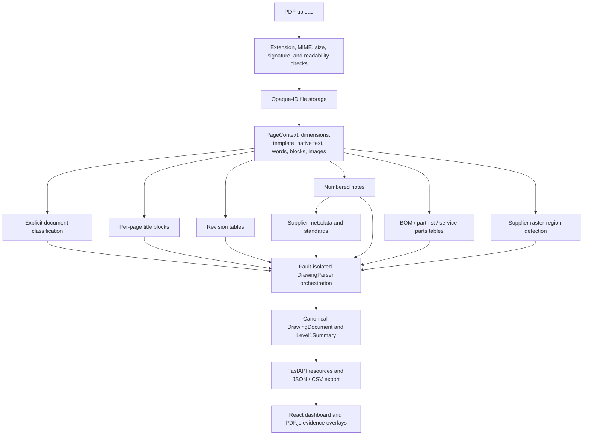

# Level-1 architecture

## Scope boundary

The system accepts PDF files only and extracts only information explicitly evidenced in the PDF. Extraction is deliberately separate from engineering validation. There is no compliance decision, GD&T correctness check, BOM approval, revision correctness check, CAD comparison, YOLO model, or full-page OCR path.

## Production flow

`DrawingParser` calls each extractor independently. Exceptions become structured warnings and do not cancel successful output from other stages. Page inspection is performed first through `PageContext`; existing stable extractors still open the PDF for their own coordinate reconstruction, which is a known performance cost rather than a semantic inconsistency.

## Canonical model

`backend/app/models/drawing.py` is the public Level-1 schema. Each semantic value is an `ExtractedField` with:

- `value`
- `page_number`
- `confidence`
- `confidence_category`
- `extraction_method`
- `bounding_box`
- `raw_text`
- `evidence_anchor`

Unknown fields use a null value and null provenance with zero confidence. Pydantic validators reject a known value without a method, an unknown value with fabricated provenance, and malformed bounding boxes.

Table rows carry one of `BOM`, `PART_LIST`, `SERVICE_PARTS`, or `UNKNOWN`. The document keeps the three table families in separate arrays. Service-parts rows and outer wrapper part lists are never relabeled as supplier BOM.

## Page context and templates

`backend/app/extraction/page_context.py` reads page size, complete native text, word tuples, text-block tuples, and image metadata. Template detection currently recognizes Club Car wrapper dimensions of 17 × 11 inches and 34 × 22 inches in PDF points. Unknown dimensions remain `UNKNOWN` and generate informational/debug evidence rather than being forced into a supported template.

Extractors use broad normalized regions only to select candidates. Labels and spatial relationships establish field boundaries; drawing values and sample drawing identifiers are never production rules.

## Extractors

- `title_block.py`: bottom-right normalized Club Car wrapper region, anchor labels, relative columns and rows, one result per page.
- `revision_table.py`: column-heading detection and coordinate row association; descriptions preserve multiline text.
- `notes.py`: NOTE/NOTES headings, sequential markers, block continuity, full wording, and embedded standard references.
- `bom.py`: coordinate-first header and row reconstruction with cropped pdfplumber fallback; table type comes from explicit headings.
- `classification.py` and `supplier.py`: explicit supplier drawing markers or supplier/manufacturer metadata only; filenames are ignored.
- `standards.py`: de-duplicates references already carrying note-level evidence.
- `supplier_raster.py`: returns large image regions only when explicit supplier evidence exists; it never invokes OCR.

## Confidence

Confidence is deterministic. `backend/app/extraction/confidence.py` starts from a documented base and applies declared positive or negative evidence features. Categories are HIGH (≥ 0.90), MEDIUM (≥ 0.75 and < 0.90), and LOW (< 0.75). Existing extractor profiles are deterministic and paired with method, raw text, evidence anchor, and bounding box so a user can understand what supports a score. Confidence measures extraction evidence, not engineering correctness.

## Persistence and API

`DrawingStore` creates a UUID directory under the configured storage root, writes uploads to a `.part` file, validates before finalizing `source.pdf`, and atomically replaces the JSON result. API callers never submit or retrieve arbitrary filesystem paths.

The canonical `/api/drawings` resources expose the complete document and focused views. JSON export preserves the exact schema. CSV export flattens evidenced fields into path, value, page, confidence, method, bounding-box, raw-text, and anchor columns.

## Frontend traceability

The frontend keeps the uploaded `File` in memory for PDF.js preview while using the API’s page dimensions and bounding boxes for overlays. Clicking a field changes the preview page and highlights the field. The evidence banner shows confidence category, score, method, anchor, and raw text. The global region toggle projects all located fields on the current page without modifying the PDF.

## Evaluation boundary

Manual truth under `tests/ground_truth` is independent of parser output. `backend/app/evaluation` resolves declared paths in the production `DrawingDocument`, calculates accuracy and coverage, and records mismatches using the Level-1 error taxonomy. The evaluator neither changes parser rules nor converts an empty truth category into a passing score.
