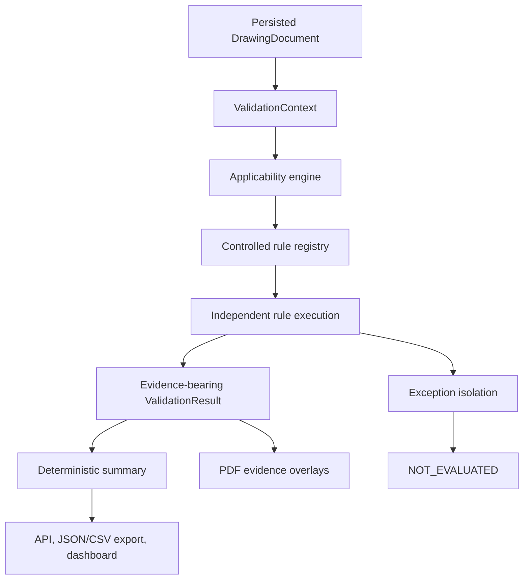

# Level-2 architecture

## Boundary

Level 2 consumes the persisted canonical Level-1 `DrawingDocument`. It never modifies extraction, reparses the PDF, infers absent evidence, or treats an extractor failure as an engineering failure.

## Components

- `validation/models.py` defines evidence, rule metadata, results, summaries, timing, and reports.
- `validation/context.py` is the read-only bridge to document-, page-, note-, table-, supplier-, standard-, warning-, and raster-region evidence.
- `validation/registry.py` owns 108 stable IDs and controlled metadata. IDs never depend on a drawing number.
- `validation/rules/base.py` defines the rule interface and normalized outcome.
- `validation/rules/declarative.py` contains reusable deterministic evaluators. Category packages keep the requested architecture boundaries visible.
- `validation/engine.py` applies configuration, applicability, exception isolation, logging, timing, and overall-status policy.
- `config/validation_rules.yaml` is JSON-compatible YAML loaded only from the repository-controlled config directory. No user-supplied Python or arbitrary config path is executed.
- `config/checklist_rules.yaml` maps every catalogued checklist item to its stable rule and automation status.

## Result semantics

- `FAIL` means reliable applicable evidence contradicts a configured deterministic condition.
- `WARNING` means a reviewable syntax/structure difference exists but is not an engineering rejection.
- `MANUAL_REVIEW` means judgment or ambiguity prevents an automated conclusion.
- `NOT_APPLICABLE` means explicit drawing evidence does not meet the rule's applicability condition.
- `NOT_EVALUATED` means a dependency, master source, visual capability, or technical execution is unavailable.

Every result includes expected and actual conditions, explanation, recommendation, version, execution time, related fields, and zero or more evidence records with page, bounding box, value, raw text, method, and confidence.

## Applicability and dependencies

Applicability is derived from document type, page count, native table families, notes, standards, supplier raster flags, and other explicit Level-1 fields. Supplier rules do not fail standard drawings; BOM, part-list, and service-parts rules remain distinct. Missing or low-confidence evidence yields manual review or not evaluated where it would be unsafe to claim failure.

## Overall status

The controlled default policy is:

1. critical failure: `FAIL`;
2. high failure, any manual review, any not-evaluated dependency, or other failure: `REVIEW_REQUIRED`;
3. warning only: `PASS_WITH_WARNINGS`;
4. otherwise: `PASS`.

This conservative PoC policy makes unresolved checks visible. It does not imply engineering acceptance.

## Persistence, API, and exports

Level-1 `result.json` remains unchanged. Level-2 writes a separate atomic `validation.json` in the opaque drawing record. JSON preserves the complete report. CSV provides one row per rule plus the review-assistance disclaimer. Structured logs contain drawing ID, rule ID, status, duration, and exception type without logging full drawing text.

## Frontend

The dashboard retains all Level-1 tabs and adds a separate VALIDATION workspace. Result evidence uses the existing PDF coordinate system. A selected cross-reference can display multiple bounding boxes. Fail, warning, manual-review, and pass overlays use color plus visible status labels and accessible region descriptions.
